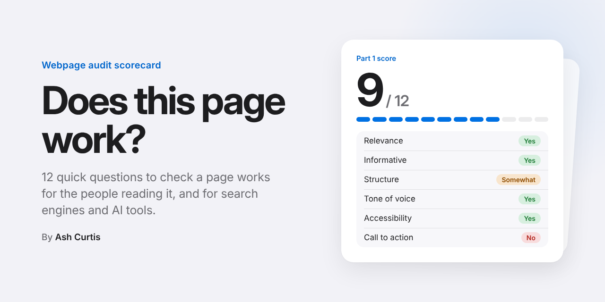

# Does this page work?

I’ve created a quick way for you to check how helpful a single webpage is.

It helps you check whether the page works for the people reading it, and whether search engines and AI tools (like ChatGPT and Gemini) can find and use it.

**[Try my webpage audit scorecard](https://ashjcurtis.github.io/webpage-audit-scorecard)**

## How it works

It takes around 10 minutes to fill in.

1. Enter the web address (URL) of the page you want to check.
2. Answer 1 question at a time, adding notes as you go.
3. Get your score and a list of what to fix, along with your saved notes.

If you type the wrong address, don’t worry. You can change it at any time using the **Edit** button at the top.

## Long read: what the scorecard checks

### Part 1: Is the page helpful for users?

You’ll answer 6 questions, choosing **Yes** (2 points), **Somewhat** (1 point) or **No** (0 points). The highest score you can get is 12.

The questions cover:

- **Relevance:** Is it clear who the page is for?
- **Informative:** Does it give people what they need?
- **Structure:** Is it easy to scan and follow?
- **Tone of voice:** Does it sound right for your readers and match your house style?
- **Accessibility:** Can everyone use it?
- **Call to action:** Is it clear what to do next?

### Part 2: Can search engines and AI tools use the page?

You’ll answer 6 more questions, choosing **Yes**, **Not sure** or **No**. This part isn’t scored, but it gives you a list of things to look at.

The questions cover:

- **Reach:** Can search engines and AI tools get to the page?
- **Store:** Will they keep a copy of it?
- **Understand:** Can they make sense of it?
- **Trust:** Does it show why people should believe it?
- **Answer:** Does it give a clear answer to a question?
- **Act:** Could someone use it to get something done?

### What you get at the end

- Your Part 1 score (shown after the first 6 questions).
- A list of Part 2 questions that need attention, with a suggested fix for anything you didn’t answer Yes to.
- A final screen to add who’s responsible for the fixes and when to review the page again.
- A downloadable PDF or spreadsheet containing your score, notes and fixes for both parts.

### How the automatic check works

For **Reach** and **Store**, the scorecard can check the page for you. It suggests an answer and adds what it found to your notes, though you can change the answer if you disagree.

It checks whether:

- anyone can open the page without signing in
- the page tells Google, Bing or AI tools to stay away
- the page appears in the site’s list of pages (the sitemap)
- the page tells search tools not to keep it
- the text is actually on the page, rather than only appearing after the page finishes loading.

### Things to know

- The tool can only see what a standard visitor sees. It can’t check pages that need a login.
- Some websites block automated checks. If this happens, the scorecard will ask you to check by hand.
- If it flags a problem, double-check it before making any changes.

## Your privacy

Your answers and notes are saved in your own browser as you go, so you can come back and carry on later. They stay on your device and aren’t sent anywhere. They’re cleared when you start a new audit.

If you use the automatic check, the page address is sent to a small service that runs the check. It doesn’t store your results, though the hosting service (Cloudflare) keeps standard request logs, which may include the page address.

## Accessibility

We’ve built the scorecard to meet Web Content Accessibility Guidelines (WCAG) 2.2 AA standards. You can use it with a keyboard, the colours are easy to read, and it works on small screens. It also has a light and dark mode, which you can switch between using the button at the top.
